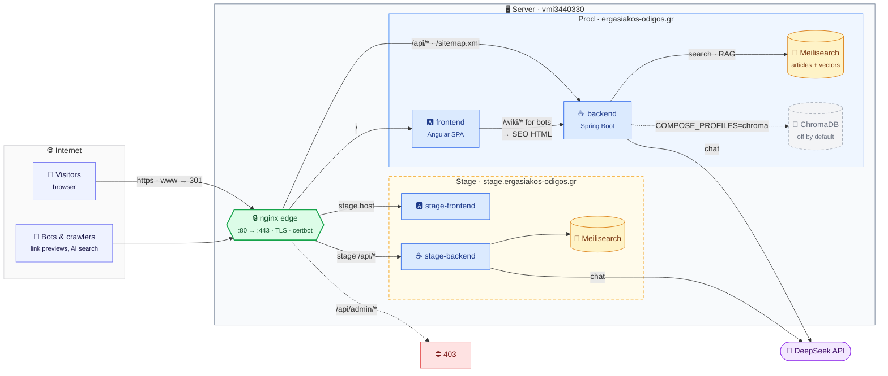
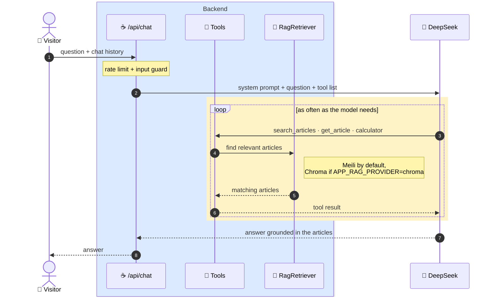
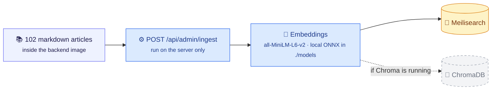

# Architecture

How the app runs in production. Stage is the same stack (smaller, no nginx/certbot); its traffic
enters through prod's nginx. Deployment and server setup: [CICD.md](CICD.md).

## Request routing

| Colour | Meaning |
|---|---|
| 🟩 green | public entry point (nginx, TLS for main domain, `www` and `stage.`) |
| 🟦 blue | application containers |
| 🟨 amber | search data (Meilisearch) |
| ⬜ grey, dashed | ChromaDB: defined but not running unless enabled |
| 🟪 purple | external service (DeepSeek) |

- **Wiki, calculators and the search box** don't use the LLM: articles are served by the backend,
  calculators are plain Java, and search always uses Meilisearch.
- **Rate limiting** applies to `/api/chat` and `/api/search`. `/api/admin/` is never reachable from
  the internet.

## Chat

Only the chat calls DeepSeek. The model decides when to look up articles or run a calculator (tool
calling), so answers are grounded in the guide rather than in the model's own knowledge.

## Ingest

Run the ingest after a deploy that changes articles, and after enabling Chroma (see CICD.md).
